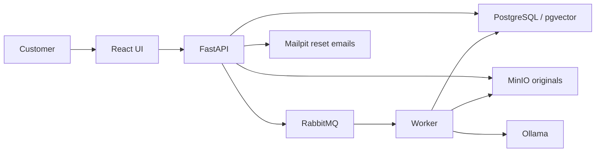

# HomeFlow

Customer mortgage application, document upload/vault, password accounts, and a background document-processing pipeline. This is a local development project; the complete LLM workflow still needs end-to-end accuracy and integration testing.

## 1. Install prerequisites

Everyone needs **Git** and **Docker with Compose v2**. No separate Node, Python, database, queue, storage, or Ollama installation is required for the Docker setup.

- Git: https://git-scm.com/downloads
- Docker Desktop: https://docs.docker.com/desktop/setup/install/
- Windows: use Linux containers and the WSL 2 backend; follow https://docs.docker.com/desktop/setup/install/windows-install/ . Restart when the installer asks, then open Docker Desktop.
- macOS: install Docker Desktop for your chip (Apple Silicon or Intel).
- Linux: Docker Desktop, or Docker Engine plus the Compose plugin: https://docs.docker.com/engine/install/ . Your user must have permission to run Docker.

Verify in a terminal:

```text
git --version
docker --version
docker compose version
docker info
```

The AI models are large downloads and CPU inference can be slow. As a practical starting point, plan for 32 GB host RAM and at least 30 GB free disk space, with adequate Docker memory allocation; these are planning estimates, not validated minimums. A GPU is optional. Docker defaults to CPU in this repository. See https://docs.ollama.com/docker for GPU configuration. Basic UI/accounts testing can skip model downloads.

## 2. Clone the repository

Clone the team repository:

```text
git clone https://github.com/Manojba1302/BUAN-6390-.git HomeFlow
cd HomeFlow
```

Run all commands from this repository root (where docker-compose.yml is located). Never use somebody else's absolute Desktop path.

## 3. First-time setup

Windows PowerShell:

```powershell
powershell -NoProfile -ExecutionPolicy Bypass -File .\scripts\setup.ps1
```

macOS/Linux terminal:

```bash
bash scripts/setup.sh
```

The script checks Docker, creates a private `.env` if missing, validates Compose, starts containerized Ollama, downloads the three default models, builds services, and starts the stack. The first run can take substantial time. Any failed Docker command stops the script; resolve its error and rerun safely. It preserves existing `.env` and database volumes.

For UI/accounts only, skip model downloads:

```powershell
powershell -NoProfile -ExecutionPolicy Bypass -File .\scripts\setup.ps1 -SkipModels
```

```bash
bash scripts/setup.sh --skip-models
```

AI classification/extraction/chat will be unavailable until the models are pulled. This mode uses the real API, not mock data.

The scripts download `gemma3:4b`, `llama3.1:8b`, and `nomic-embed-text`. If you change model settings, pull those additional model names yourself. Do not change the embedding model without handling its vector dimensions and reindexing stored data.

## 4. Open and test

| Service | URL |
|---|---|
| HomeFlow | http://localhost:5173 |
| API documentation | http://localhost:8000/docs |
| API liveness | http://localhost:8000/api/v1/health |
| Partial readiness check | http://localhost:8000/api/v1/ready |
| Password-reset emails (local only) | http://localhost:8025 |
| RabbitMQ console | http://localhost:15672 |
| MinIO console | http://localhost:9001 |
| Ollama on host | http://localhost:11435 |

1. Create an account using a new test email and a password of at least 9 characters, including uppercase, lowercase, a number and a symbol (such as `@`).
2. Confirm the profile shows your identity and customer ID.
3. Log out and back in.
4. Request a reset link. Open the message in Mailpit at port 8025 and follow the link. Reset links expire after 30 minutes and revoke previous sessions.
5. Upload fictional/sample documents, inspect their status, and check worker logs. Do not commit customer documents to Git.

Old email-only demo customer rows cannot be claimed by registration. Use a new email; verified legacy-account migration is a separate task. Email verification and MFA are not implemented. The local email inbox does not send mail to real recipients.

`ready` currently checks database and Ollama connectivity only; it does not prove models are installed, storage/queue health, or extraction accuracy.

## 5. Daily commands

Windows:

```powershell
.\scripts\homeflow.ps1 start
.\scripts\homeflow.ps1 status
.\scripts\homeflow.ps1 logs
.\scripts\homeflow.ps1 test
.\scripts\homeflow.ps1 stop
```

macOS/Linux:

```bash
bash scripts/homeflow.sh start
bash scripts/homeflow.sh status
bash scripts/homeflow.sh logs
bash scripts/homeflow.sh test
bash scripts/homeflow.sh stop
```

If PowerShell blocks scripts, invoke them with the same process-scoped `powershell -ExecutionPolicy Bypass -File ...` command as setup. No global execution-policy change is necessary.

Equivalent manual commands:

```text
docker compose -f docker-compose.yml -f compose.auth.yml --profile models up --build -d
docker compose -f docker-compose.yml -f compose.auth.yml --profile models ps
docker compose -f docker-compose.yml -f compose.auth.yml --profile models logs -f backend worker
docker compose -f docker-compose.yml -f compose.auth.yml --profile models down
```

Stopping preserves named volumes containing accounts, documents, models, and markdown. Do not add `-v` unless you intentionally want to erase local data. The Compose project and package name are `homeflow`. Fresh clones create HomeFlow-named containers and volumes. Existing installations can retain their old Compose project/volumes via the private COMPOSE_PROJECT_NAME setting in .env; do not rename or delete initialized volumes. Existing .env credentials override the new HomeFlow defaults.

## 6. Configuration and troubleshooting

`.env.example` contains local development defaults. `.env` contains your private configuration and is ignored by Git. Never commit real passwords or mail credentials. Database/queue/storage defaults are for local development only; all published ports bind to localhost.

- Missing `.env`: setup creates it, or copy `.env.example` to `.env` yourself.
- Existing old `.env`: set `OLLAMA_BASE_URL=http://ollama:11434` for the standard containerized setup. Remove obsolete `DEV_AUTH`; it is no longer used.
- Ports already occupied: stop the conflicting local service or change the corresponding `WEB_PORT`, `API_PORT`, `DB_PORT`, `QUEUE_PORT`, `QUEUE_UI_PORT`, `STORAGE_PORT`, `STORAGE_UI_PORT`, or `OLLAMA_PORT` in `.env`. For frontend/API port changes also update `FRONTEND_URL`, `CORS_ORIGINS`, and `VITE_API_BASE`, then rebuild. Internal container ports stay unchanged. Mailpit uses port 8025; change compose.auth.yml if needed.
- MinIO image unavailable: this repository builds a pinned MinIO source release in `infra/minio/Dockerfile`; it does not depend on removed `minio/minio:latest` images or images on a teammate's machine.
- Reset email absent: check Mailpit is running and backend logs. Compose defaults use `SMTP_HOST=mailpit`, port 1025, without TLS. Deployment needs real SMTP, HTTPS, `COOKIE_SECURE=true`, and appropriate allowed origins.
- AI unavailable: inspect `docker compose --profile models exec ollama ollama list`; pull missing models using `docker compose --profile models exec ollama ollama pull MODEL_NAME`. CPU processing may exceed existing request timeouts.
- Changed database passwords do not update an already initialized PostgreSQL volume. Keep credentials consistent or perform a deliberate database password migration.
- SQL initialization scripts run only on a fresh PostgreSQL volume. Auth tables are added at API startup; later database schema changes need migrations.
- Login errors: inspect backend logs and use the same `localhost` hostname consistently; do not mix it with `127.0.0.1` in one session.

### Saved document conversations

Chat history is stored in PostgreSQL per customer and application. Reopening chat restores saved questions, answers, and source references. Use the conversation selector to revisit earlier chats, **New chat** to start an empty conversation, and **Delete conversation** to remove its messages without deleting documents.

New questions use current extracted data and saved corrections. Follow-up questions can refer to a single recently discussed document; ambiguous references ask you to choose a document. Historical answers keep their original text and show a notice when a source changes or becomes unavailable. Unsaved edits in a correction form are not used until saved. Messages from the previous in-memory chat implementation cannot be recovered.

Fresh databases run `db/init/008_chat_history.sql` automatically. For an existing installation that already has migrations 001–007, run this once from the HomeFlow folder in PowerShell, then restart the backend:

```powershell
Get-Content -Raw db/init/008_chat_history.sql | docker compose exec -T db sh -c 'psql -v ON_ERROR_STOP=1 -U "$POSTGRES_USER" -d "$POSTGRES_DB"'
docker compose -f docker-compose.yml -f compose.auth.yml restart backend
```

This migration adds two history tables and preserves existing accounts and documents. Closing chat cancels the browser's wait; an answer already being generated can still finish and be saved. Reopening chat reloads its status.

## 7. Folder map

- `frontend/`: React/TypeScript UI, login and account screens.
- `backend/`: FastAPI endpoints, authentication, database models and tests.
- `worker/`: queued document processing.
- `shared/`: document definitions and processing helpers used by API/worker.
- `db/init/`: initial PostgreSQL/pgvector schema and seed data.
- `infra/minio/`: portable storage image build.
- `scripts/`: setup and daily commands.
- `SPECIFICATIONS.md`: technologies/models and current limitations.

## 8. Before pushing to GitHub

Commit source, Dockerfiles, compose files, scripts, lockfiles, docs, and `.env.example`. `.gitignore` excludes private environment files, generated caches/builds, logs, screenshots, and uploaded data. Do not put real borrower information in source fixtures.

```text
git status --short
git check-ignore .env
```

If this folder is not a Git repository, run `git init` first. Review staged files before committing. Git ignore rules do not untrack an already committed secret; rotate any exposed credentials. Do not push generated Docker volumes, model weights, node_modules, or virtual environments.

## Verification status

Frontend build and isolated authentication tests passed on the developer machine. Authentication tests use a temporary SQLite database and a test mail sender; they do not validate live PostgreSQL/SMTP delivery. Compose configuration is validated. Fresh-machine builds, macOS/Linux startup, GPU performance, and the full LLM pipeline still need team testing; model latency budgets are goals, not measured guarantees.


## 9. How HomeFlow works

### Services and responsibilities

| Component | What it does | Where its data lives |
|---|---|---|
| React frontend | Account screens, six application sections, conditional income questions, upload preview, document vault, extraction review and progress | Saved answers come from the API; temporary UI state is not a substitute for saving |
| FastAPI backend | Authenticates requests, checks document/application ownership, validates inputs, saves answers, accepts uploads and exposes document/chat endpoints | PostgreSQL metadata; document bytes in MinIO |
| PostgreSQL + pgvector | Stores customers, applications, answers, authentication, document metadata, extracted evidence and searchable vectors | Named database volume |
| RabbitMQ | Hands accepted document jobs to the background worker so processing does not block the application form | Named queue volume |
| Worker | Reads PDFs/images, attempts OCR, classifies, extracts fields, creates markdown and embeddings, and updates processing status | Writes results to PostgreSQL and configured storage |
| MinIO | Stores original uploaded file bytes in S3-compatible object storage | Named storage volume |
| Ollama | Runs local vision, text-generation and embedding models | Model downloads persist in the Ollama volume |
| Mailpit | Captures local password-reset messages for development | Local inbox; it does not deliver real email |



Ollama is the model runtime, not the entire document system. HomeFlow code performs file validation, page preparation, ownership checks, field mapping and storage. Vision handles image/scanned content; the text model handles readable text and structured responses; the embedding model turns document chunks and questions into vectors for retrieval. Models can return incorrect or incomplete results, so extraction review remains necessary.

### Account and application workflow

1. **Create account:** enter names, email and a password of 9–128 characters with uppercase, lowercase, a digit and a non-whitespace symbol such as `@`. Registration and password reset enforce this server-side. Existing accounts can still sign in with their original passwords.
2. **Authenticated session:** the backend creates a customer ID and a server-side session. The browser receives an HttpOnly, SameSite cookie. Passwords are stored as salted scrypt hashes, not plaintext. Sessions last eight hours; logout invalidates the server token.
3. **Application:** an application ID identifies a particular application owned by that customer. The customer ID is shown in the profile; application ID and completion progress belong to the application. They are separate identifiers.
4. **Get started:** capture the home goal, contact/property basics and employment situation. Employment selection changes the relevant income questions and document requests.
5. **Documents:** add identification and financial evidence, then review the processing results. Current core document types are driver’s license, Social Security card, bank statement, payslip and W-2. Income document requirements depend on the selected employment situation.
6. **About you / Property / Income & finances:** complete the appropriate application questions and save changes. The SSN input is visible while editing and masked afterward in the UI; masking is a display behavior, not encryption.
7. **Review:** inspect answers, missing requirements and document-derived values before submitting. Submission here is an application record action; it does not automatically deliver a loan to an external lender.
8. **Resume:** sign in again to access your own saved applications and documents. Another customer's identifiers do not grant access.

### Document workflow, including scans

1. Select the intended document type and choose a supported PDF/image. Preview helps the customer inspect the selected file.
2. Preview is local for selected PDF/image files. Classification starts on the backend only after the customer presses Submit; no classify request is made on file selection.
3. HomeFlow compares the selected type with detected content and reports uncertainty, disagreement or mixed documents. Classification currently inspects up to the first six pages, so it does not guarantee detection of every document in a long mixed PDF.
4. After Submit, the selected file is classified. Mismatched/unknown files remain available for review; successful uploads are removed from staging while failures remain for retry. The accepted upload creates a file ID, ownership/application metadata, storage key, checksum and processing status; the original bytes are stored in MinIO and a job is queued.
5. The worker reads embedded PDF text where available. For scans/images, it prepares page images and attempts OCR; vision provides another path when usable text is unavailable.
6. Classification/extraction combine model responses with document definitions and parsing logic. Extracted values retain provenance such as page, evidence, method and review state where available.
7. The pipeline produces markdown and searchable document chunks/embeddings. The API exposes status and extraction results; the customer reviews/corrects values before relying on prefilled application answers.
8. The vault lists saved documents and their status. An upload existing in storage does not mean extraction has finished successfully. Inspect status/error details and worker logs when a file remains pending or fails.

### Document chat / retrieval

The chat API retrieves relevant document chunks within the authenticated customer's scope, then uses the text model to answer from that context. Retrieval requires successfully processed and embedded documents. Test the endpoint through API documentation with an authenticated session. A complete polished customer chat experience and banker portal are not established by the presence of this API; assess those separately before demonstrating them as finished features.

### Database and ownership model

- `customer` stores customer identity; `auth_account` stores password hashes and login lockout state.
- `auth_session` stores hashed session tokens and expiry; `password_reset` stores single-use reset-token records. Resetting a password revokes existing sessions.
- `application` belongs to a customer; `application_field` stores saved values, their source and review/provenance details.
- `file` belongs to a customer and may reference an application. It stores metadata and a storage key rather than the original binary in PostgreSQL.
- `file_classification` records selected/detected type, outcome and evidence; `extraction` records document-derived field values. Additional schema tables support financial/application entities and retrieval.

Use `db/init/001_schema.sql` and backend ORM models as the detailed schema reference. Customer/application IDs are generated identifiers, not SSNs. Never infer access rights from frontend filtering alone; protected API routes perform ownership checks.

## 10. Source guide for developers

| Path | Start here when changing… |
|---|---|
| `frontend/src/AuthPage.tsx` | Login, registration, recovery, password visibility and requirements |
| `frontend/src/App.tsx` | Application navigation, identity, forms and UI state |
| `frontend/src/api.ts` | Browser/API requests and session handling |
| `frontend/src/bank-layout.css` | Application and account layout/theme |
| `frontend/src/icons.tsx` | Shared SVG icon system |
| `backend/app/api/v1/auth.py` | Registration, login, reset email and password rules |
| `backend/app/core/security.py` | Password hashing, session lookup and origin checks |
| `backend/app/api/v1/applications.py` | Owned applications, saving and progress |
| `backend/app/api/v1/documents.py` | Classification, upload, status, extraction corrections and content |
| `backend/app/api/v1/chat.py` | Document retrieval and answers |
| `backend/app/db/models.py` | ORM/table mapping |
| `worker/worker/main.py` | Queue consumption and processing orchestration |
| `worker/worker/pipeline.py` | Reading, OCR, classification, extraction and embeddings |
| `shared/pages.py` | PDF/image page preparation |
| `shared/doc_types.py`, `shared/document_types.json` | Supported document definitions and classification rules |
| `shared/ollama.py` | Model HTTP calls and response handling |
| `.env.example` | Team configuration template |
| `docker-compose.yml`, `compose.auth.yml` | Service wiring, volumes, ports and local reset-email service |

## 11. Team verification checklist

After first startup, use `scripts/homeflow.ps1 test` (Windows) or `bash scripts/homeflow.sh test` (macOS/Linux) for isolated authentication checks. Then verify the actual running stack:

- Register, sign out, sign in and recover a password through Mailpit.
- Save answers, refresh and confirm the correct account/application loads.
- Upload fictional examples of each supported type, including a scanned PDF and a long/mixed PDF. Check detected type, extraction evidence and failure handling.
- Correct an extracted value and confirm the saved application reflects the intended reviewed answer.
- Use a second account to verify that the first account's application/documents remain inaccessible.
- Confirm models are installed with `docker compose --profile models exec ollama ollama list` and inspect worker logs during processing.

The authentication suite covers ownership, session expiry/logout, reset replay, rate limits and password rules in an isolated database. It does not prove document accuracy or live SMTP/database integration. Keep model evaluation results separate from build/test success.

## 12. Troubleshooting by workflow

| Symptom | First checks |
|---|---|
| Browser cannot open HomeFlow | Docker running; Compose `ps`; frontend logs; correct WEB_PORT |
| Account request fails | Backend logs; database health; allowed origin; consistent localhost hostname |
| Reset link never appears | Mailpit/backend running; SMTP configuration; inspect local inbox; repeated requests may be limited |
| Upload fails immediately | Supported file type/size; API error details; storage service; signed-in session |
| Upload stays pending | Worker running; RabbitMQ connectivity; worker logs |
| Classification says unknown | Readable scan, available model, timeout/error logs; confirm document type manually where allowed |
| AI processing is slow | CPU/model size, Docker RAM, missing models and request timeouts |
| Chat has no useful evidence | Documents finished processing; chunks/embeddings exist; correct account/application scope |
| Old data seems missing | Compose project name and volume names match the previous installation |

For a code update after pulling from GitHub, rerun the normal `start` command to rebuild. Read schema changes before updating an existing database: initialization SQL is not a migration system. Back up existing named volumes before any deliberate destructive reset. No setup script automatically deletes customer data.

Account creation and password reset include a confirm-password field with live matching feedback. The UI shows missing requirements and supports show/hide for both fields. The symbol requirement accepts printable ASCII punctuation from the [OWASP reference](https://community.owasp.org/password-special-characters). Spaces may occur but do not satisfy this requirement. This is HomeFlow policy, not an OWASP certification. The account screen uses a full-screen home-photo background.

## Source-based document collection

The supplied Consumer_RE_Requirements_and_Flow.html (Application step 6 and rules R-UW-1/R-UW-3) specifies two latest paystubs, two years of W-2s and two months of bank statements per account for an owner-occupied W-2 purchase. The Oct 1 meeting notes additionally request Social Security card/driver’s-license categories and client-side preview before Submit. Build a multi.docx describes configurable checklists across products and tenants; it does not establish a universal three-month period.

Checklist file counts are collection indicators. They do not yet verify distinct statement months, all accounts/pages, or W-2 tax-year coverage. A combined multi-period PDF may require manual review; automatic period-aware completeness remains separate work. The UI keeps configured guidance visible after upload and shows local previews for images/PDFs before server submission. Saved documents open through their existing detail view.

## Docker naming and existing installations

Fresh installations use the homeflow Compose project, HomeFlow service names and named persistent volumes for the database, storage, markdown and queue. RabbitMQ uses a stable hostname so queue data survives container recreation.

For an existing installation, stop its old stack without deleting volumes before changing the project name. Set COMPOSE_PROJECT_NAME=homeflow in your private .env. To reuse existing volumes, set REUSE_DATA_VOLUMES=true and specify DB_VOLUME_NAME, STORAGE_VOLUME_NAME, MARKDOWN_VOLUME_NAME and QUEUE_VOLUME_NAME using the actual existing volume names. Preserve RABBITMQ_HOSTNAME when reusing an existing RabbitMQ data volume. All four external volumes must already exist. Fresh clones should leave these overrides unset. Never commit your private .env.


### Vault ownership and application documents

Uploaded files belong to the customer vault. An application uses an existing vault file through its application link.

- **Remove from application** unlinks the file and updates the checklist. The original, extraction, markdown and vectors remain in My Vault. Unconfirmed values derived from that file are cleared; customer-confirmed values are preserved.
- **Choose from My Vault / Use in application** attaches an unattached file without uploading a duplicate. Completed extraction is applied to the draft application.
- **Delete permanently** is an explicit, confirmed vault action. It deletes the stored original, generated markdown, classification, extraction and vectors. Retained customer-confirmed application values lose their deleted evidence reference.
- Submitted application documents cannot be removed or deleted. Wait for queued/processing files to finish before permanent deletion.
- The current schema links a file to one application at a time. Simultaneous reuse across applications requires a future junction table.

Run the lifecycle integration check against the local stack (it creates and cleans its own synthetic records; it does not use customer documents):

```powershell
docker exec -e PYTHONPATH=/srv/app:/srv/shared -e HOMEFLOW_INTEGRATION_TEST=1 homeflow-backend-1 python tests/document_lifecycle_test.py
```


### Updating an existing checkout

Commit or stash your own changes before updating:

```powershell
git pull origin main
```

Existing `.env` files are private and are not overwritten by Git. Set `CLASSIFIER_MODEL=gemma3:4b` and `VISION_MODEL=gemma3:4b` in your `.env`. Keep `EXTRACTOR_MODEL=llama3.1:8b` and `EMBED_MODEL=nomic-embed-text`.

For Docker-managed Ollama, run the setup script again to download the required models and rebuild services:

```powershell
.\scripts\setup.ps1
```

For a host-installed Ollama (with your existing `OLLAMA_BASE_URL` pointing to it):

```powershell
ollama pull gemma3:4b
ollama pull llama3.1:8b
ollama pull nomic-embed-text
docker compose -f docker-compose.yml -f compose.auth.yml up --build -d
```

Refresh the browser after the services finish starting. These updates preserve existing Docker data volumes; do not use `down -v` to update. Local accounts and documents are not distributed through Git.


Name review preserves full names and supports user-confirmed first and last name corrections. Document-owner assignment and cross-person prefill policies are deferred pending Vijay’s clarification. Monetary extraction preserves decimal cents; original model readings and user corrections are retained.

### Account identity and document name suggestions

The welcome message and profile avatar use the signed-in account name. Extracted document names do not change that identity. Application names require review: the form offers separate suggestions with document type, filename and source page. Selecting a suggestion fills its explicit first and last names together; a full name alone is not automatically split. Save and continue confirms the chosen or manually entered name, and subsequent uploads cannot overwrite it. Existing unconfirmed extracted name proposals are cleared when loading the application; confirmed answers remain editable. Different document names are flagged for review, without assigning borrower/co-borrower roles or asserting that the documents belong to the same person. Review other extracted details separately.

### Residential address review

Document addresses are source-labelled suggestions, not automatic residential address updates. Choose an explicitly extracted complete street/city/state/ZIP combination from one document or enter your current residence manually, then Save and continue to confirm it. Incomplete addresses are shown for review but cannot be selected as a complete address. Confirmed values and property address fields are preserved. W-2, pay-stub and bank-statement extraction requests employee/account-holder mailing addresses only, excluding employer and bank addresses. Existing documents reuse a saved owner-name evidence quote when it contains one clearly structured US mailing address consistent with existing fields. Recovered parts are saved with the original page and quote, without a second model call. Ambiguous, conflicting or unsupported address text stays unresolved; reprocessing is only needed when the saved evidence is insufficient.

### Employment matching and review

Employer matching ignores capitalization and repeated whitespace. Documents do not overwrite a customer-confirmed employment entry. Pay-stub income is available as a source-labelled proposal with employee name and monthly-income calculation; the customer explicitly chooses whether to use it. Existing same-employer entries can be reviewed in a combine preview, with choices for conflicting fields and no addition of duplicate income amounts. Combining takes effect on Save and continue. Separate positions can remain separate, and multiple matching jobs are never automatically merged or updated. Names that differ beyond capitalization/spacing are not treated as equivalent automatically.

### Pay rate versus gross earnings

Pay-stub extraction separates printed job title, contractual pay rate and its explicit basis, regular earnings, overtime, bonuses and period gross totals. Base monthly income uses only a printed non-hourly contractual rate: semimonthly 617.50 converts to 1235.00 monthly even when period gross is 961.88. Gross, net and YTD totals are never treated as base salary. Hourly rates require standard-hours review. Existing saved document text can recover explicit labelled Pay Rate and Job Title without another model call; corrections remain authoritative. Income and job-title proposals have separate acceptance actions; confirmed values are not silently changed.

### Income validation and employment history

Current jobs require positive monthly base income to mark Income & finances complete. Previous jobs remain employment history and are excluded from the current employment total; they do not require a current base amount. Currency inputs accept formatted values and blank dates are saved as null. Negative, nonfinite, malformed or oversized employment amounts are rejected before any application fields are saved. Overtime, bonuses and commissions are monthly amounts. Switching a previous job back to current clears its end date. Same-employer history is not automatically matched to a current job.


### Document assistant and employment verification

Uploads propose employers; they do not create employment rows. The customer adds an employer once and reviews source-labelled pay-stub income and title suggestions. Multiple W-2s and pay stubs can support that job. Existing duplicate entries require an explicit combine review and Save and continue. Label/value columns in native PDFs are aligned using page coordinates to recover printed Job Title and Pay Rate without another model call. Job title and contractual rate/basis are optional document details; missing base monthly income still prevents completion for current employed applicants.

Use **Ask documents** in the application header to open the document assistant. Each question is independent and scoped to completed documents linked to the current application and owned by the signed-in customer. The prompt includes source file IDs, page text, stored extracted readings for that page, and saved document corrections; corrections take precedence over original values. Citation file/page pairs are validated against retrieved sources before displaying an answer. Source buttons open document review. Invalid sources or unverified answers produce a review message instead. This checks source identity, not the factual accuracy of every model-generated sentence; review source documents before relying on an answer.

The assistant currently answers document questions, not application progress or unsaved form edits, and does not approve loans. Ollama must be running with the configured answer and embedding models. Model/network errors appear in the panel and can be retried. No database columns were added for these changes.


Simple field questions now use a read-only allowlist before vector search: license expiry/issue dates, birth dates, names, addresses, pay rates/basis, job titles, employer names, pay dates/periods, bank balances/statement periods/deposit and withdrawal totals, and W-2 years/wages/tax. These answers query customer-owned files in the selected application, preserve explicit saved corrections (including intentional blanks), and list each matching document/owner separately. Missing values return a document-review link instead of an invented answer. Questions requiring explanation, comparison or calculations retain the document-search/LLM path. Recognized field questions never require Ollama; unfamiliar wording may still fall back to search.


Document inventory supports count/list wording (including “How many documents do I have?” and document-type counts) without Ollama. Inventory results are labelled with their application/account scope and offer document links rather than fabricated page citations. The chat panel supports stopping the browser request, cancels it when the panel closes, and shows elapsed-wait feedback. Browser cancellation stops waiting for the reply; an already-running Ollama job may continue until the server-side timeout. Field and inventory routing currently use tested synonyms, so unfamiliar wording can still take the slower search path; explanation requests depend on local model speed and availability.


### Chat question regression set

`backend/tests/fixtures/chat_questions.json` contains 248 synthetic field-question cases across the five supported document types. `tests.chat_question_matrix_test` checks the saved-field route and additional natural-language examples, identifier masking, and correction handling. Run from the backend environment: `python -m unittest tests.chat_question_matrix_test tests.chat_grounding_test`. Database tests additionally verify ownership, missing fields, per-document answers and counts. This is a regression/evaluation set, not LLM fine-tuning or proof of extraction accuracy. New document types need a catalogue definition, extraction/validation examples, and representative document tests before they are considered supported. SSN, license and account identifiers are masked in direct chat answers; users can reveal sensitive fields through authenticated document review.

### Chat model evaluation (October 10, 2026)

`CHAT_MODEL` selects only the broader chat answer model; it does not change `EXTRACTOR_MODEL`, `VISION_MODEL` or `EMBED_MODEL`. The default remains `llama3.1:8b`. To evaluate an alternative, pull its Ollama model first, set `CHAT_MODEL` in the private `.env`, and recreate the backend using your normal Compose files. Restarting alone does not reload changed environment variables.

Local CPU testing of `llama3.2:3b` completed eight broader questions in 9.6–35.1 seconds, whereas the earlier 8B baseline timed out on three questions around 45 seconds. Faster answers did not establish correctness: observed errors included an invented pay basis, misleading address comparisons, incomplete comparison citations and a future-pay claim. Four targeted retests after prompt/retrieval improvements completed in 14.4–42.2 seconds; incomplete comparisons and source mislabelling remained. The 3B model is therefore **not approved as the default**.

Chat now balances retrieved passages across files, filters explicit document types, removes duplicate pages, supplies source-type metadata and caps generated output. Cross-document comparisons without citations covering each supplied source are rejected with document review links. Next-paycheck questions receive an explicit limitation rather than a prediction. These checks reduce risk but do not prove every generated statement is true. The regression suite covers field routing, saved corrections, account isolation, history and citation handling; live model evaluation remains separate from those deterministic tests.

The final live employer comparison exposed a hyphenated `W-2` alias bug, now fixed and regression-tested. With both sources present the 3B model returned two valid citations in 25.7 seconds, but incorrectly described an employee address as an employer address and omitted the pay-slip employer. Valid citations alone therefore cannot establish semantic correctness. The final deterministic suite passed 47 tests (including the schema-driven field-question matrix). Extraction model settings and stored customer records were not changed by this evaluation.

### Structured chat comparisons

Employer-name comparisons, document-holder address comparisons and pay-rate-versus-gross explanations now use saved extracted fields directly, before model search. Saved corrections (including intentionally blank corrections) take priority. Results list each document separately with page references; employer names are compared only after case/whitespace normalization, and full address components remain together. No identity, job merge or current-residence decision is made automatically. Missing or processing data is identified explicitly. These answers describe the saved readings; they do not independently verify OCR accuracy or document authenticity.

Local validation answered the three previously failing cases in 0.004–0.009 seconds without any model call. The expanded regression suite passed 53 tests. Open-ended summaries still use the configurable LLM route and retain the previously documented CPU performance and accuracy limitations.

### General evidence-based document chat

Use **Other document** for an optional supported PDF/image outside the predefined categories. It remains subject to the existing classification/override review flow; choosing Other does not verify authenticity or ownership. The worker preserves readable text and page numbers without requiring predefined extraction fields. Unknown files do not populate application fields automatically. Blank/unreadable scans still require a clearer upload; the system cannot search text it could not read.

Readable chunks are now stored even if the embedding service fails. Hybrid retrieval searches page text and saved extracted fields, with vector search when available and keyword fallback when embeddings are unavailable. Every query filters customer ownership and the application association before returning evidence. Previously discarded chunks are not reconstructed automatically; affected documents need reprocessing through the supported processing flow.

Evidence includes document type, page, saved values, correction origin and field role (document holder, employer or period). Intentionally blank corrections remain unknown. The chat model is asked for a schema-constrained response containing source IDs, pages and supporting quotes; invented or missing quotes are rejected with review links. A quote match is not a guarantee of semantic accuracy. The existing structured fast paths remain, while unqualified questions with an Other document present use general retrieval to avoid interpreting an unfamiliar document as a driver's license.

Exact tools support explicitly named pairs of extracted amounts (sum or absolute difference) and ISO dates (days between), separately for each document. They preserve cents with Decimal, reject missing/nonfinite values, and do not combine different people, currencies or pay periods. Requests with ambiguous operands continue through evidence search instead of guessing a calculation. Examples: `What is the difference between gross pay and net pay?` and `How many days between issue date and expiry date?`.

Model evaluation remains ongoing. With compact synthetic unfamiliar lease/insurance evidence, the 3B candidate returned quote-supported answers in 8–9 seconds. Larger real summaries still timed out or failed support checks, and the retained 8B default timed out even on a small lease example on this CPU. These limitations remain; the new architecture must not be described as guaranteeing broad question answering or as an approved 3B model switch.

Final general-pipeline checks: 60 backend tests and 30 worker tests passed; TypeScript/Vite build passed. An end-to-end isolated test confirmed that `When does my lease expire?` uses an Other document's text rather than a license expiry fast path, even with embeddings offline. The installed `gemma3:4b` candidate answered the short unfamiliar insurance example in 36.3 seconds but timed out on the real pay-slip summary; it was not adopted. No existing customer records were reset or migrated for this change.


### Chat session and typography update (October 17)
Chat opens a new active conversation; closing resets active context. History remains available separately, and messages send a session context cutoff so historical references are not silently reused. New history omits raw document passages and applies targeted identifier/email redaction; legacy stored rows are not rewritten. See `docs/vijay-chat-requirements.md` for limitations and evaluation results. Chat generation logs first-token and total time server-side; validated answers are still delivered as a complete response.

Typography uses locally bundled `@fontsource-variable/lexend` and `@fontsource-variable/fraunces`, inspired by treasury.sh. Run `npm ci` in frontend after pulling, or rebuild its Docker image. No external font service receives customer browsing requests.


### Metadata-only chat evaluation lake
Optional evaluation logging now writes to a separate private MinIO bucket without question/answer text or raw customer/document identifiers. It records routing, source pseudonyms, available retrieval scores, model configuration and stage timings. Enable with `CHAT_EVALUATION_ENABLED=true` and a dedicated `CHAT_EVALUATION_HMAC_KEY` in your untracked environment, then recreate the backend. See `docs/chat-evaluation-lake.md` for retention, privacy and best-effort delivery limitations. Generate a daily report with `docker compose exec backend python -m scripts.summarize_chat_evaluations --date YYYY-MM-DD`. Outcome counts measure system behavior, not model correctness.


### Synthetic chat quality checks
`backend/scripts/run_chat_quality.py` runs authored fact/source checks on isolated synthetic documents. Nine deterministic cases run by default; `--live-model` enables four general RAG/model cases. The runner requires a disposable PostgreSQL database named `review` and never uses customer records. See `docs/chat-quality-evaluation.md` for setup, recorded results and grading limits. Passing these checks is not proof of production LLM accuracy.
